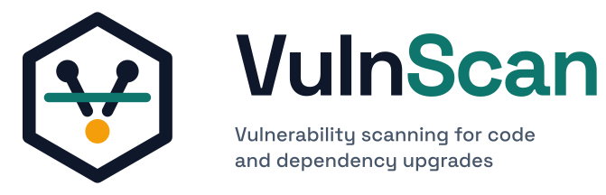

<p align="center">
  <picture>
    <source media="(prefers-color-scheme: dark)" srcset="logo/vulnscan-logo-dark.svg">
    <source media="(prefers-color-scheme: light)" srcset="logo/vulnscan-logo-light.svg">
    
  </picture>
</p>

<p align="center">
  <a href="https://github.com/MESH-Research/vulnscan/actions/workflows/ci.yml"></a>
  <a href="https://github.com/MESH-Research/vulnscan/tags"></a>
  <a href="https://github.com/MESH-Research/vulnscan/commits/main"></a>
  <a href="https://github.com/MESH-Research/vulnscan/issues"></a>
  <a href="LICENSE"></a>
  
</p>

# vulnscan

Point vulnscan at a Python, PHP, WordPress or Node.js project and it tells you
which of your direct dependencies have known security advisories, which versions
fix them, and every manifest in which each one is declared. It reads the
container images in your Dockerfiles and Compose files too, so a flaw in the
PHP interpreter, Traefik or Postgres you run shows up alongside one in a
library. It can rewrite those manifests and image tags for you, publish the results as RSS and Atom feeds or as Markdown and
plain-text reports, and push a notification to your phone or a Microsoft Teams
channel the first time a new advisory appears.

- **Sources:** [OSV.dev](https://osv.dev) for PyPI, Packagist and npm packages
  (no key needed);
  [Wordfence Intelligence](https://www.wordfence.com/threat-intel/) for
  WordPress core, plugins and themes installed through Composer (free API key);
  the [NVD](https://nvd.nist.gov) for the software inside container images
  (no key needed; an optional free key raises the rate limit).
- **Manifests:** `composer.json`; `package.json`; `pyproject.toml` (PEP 621, PEP
  735 dependency groups, Poetry); `requirements*.txt` and `requirements/*.txt`
  with `-r` includes; `Pipfile`; `setup.cfg`; Invenio `webpack.py` theme
  bundles; `Dockerfile` / `Containerfile` (every `FROM`, with `ARG` defaults
  substituted); `docker-compose*.yml` and `compose*.yml` (every service
  `image:`); GitHub Actions workflows (`container:`, `services:`,
  `uses: docker://`); GitLab CI (`image:`, `services:`, `default:`). Installed versions come from `composer.lock`, `package-lock.json`,
  `npm-shrinkwrap.json`, `yarn.lock`, `pnpm-lock.yaml`, `uv.lock`, `poetry.lock`
  and `Pipfile.lock`; image versions come from the tag.
- **Interfaces:** an interactive terminal UI; non-interactive modes for cron; a
  continuous watch mode that notifies [ntfy](https://ntfy.sh) and/or Microsoft
  Teams.
- **Looking ahead:** every upgrade it offers is forward-checked against OSV
  and the registry, so it never proposes a version with its own advisory, a
  malware report or a yank, and it warns when a version is hours old.
  `--preflight` resolves each manifest from scratch in a temporary directory
  and scores what an update would pull in, with a JSON report and exit codes
  for CI.
- **Scope:** direct dependencies by default. With `--transitive` (or
  `VULNSCAN_TRANSITIVE=true`) every package a lock file records is scanned too,
  marked as transitive together with the packages that require it.

Full documentation, including an API reference, lives in [`docs/`](docs/) and
builds with MkDocs (`uv run mkdocs serve`).

## Quick start

Requires Python 3.12 or newer and [uv](https://docs.astral.sh/uv/).

```
git clone <repository url>
cd vulnscan
uv sync
uv run vulnscan --path /path/to/project
```

That opens the TUI. For WordPress projects, put a Wordfence Intelligence API key
in `.env` first (see [Wordfence API key](#wordfence-api-key)).

## Usage

### Interactive

```
uv run vulnscan --path /path/to/project
```

| Key     | Action                                                                |
| ------- | --------------------------------------------------------------------- |
| `↑` `↓` | Move between dependencies / advisories                                |
| `Tab`   | Switch between the dependency and advisory tables                     |
| `o`     | Open the selected advisory (osv.dev or wordfence.com) in your browser |
| `f`     | Write the RSS and Atom feeds                                          |
| `e`     | Export Markdown and plain-text reports                                |
| `u`     | Upgrade the selected dependency in every manifest that declares it    |
| `p`     | Run preflight against the current on-disk pins (after upgrades this session) |
| `n`     | Return to the last normal or outdated scan result (from preflight)    |
| `r`     | Rescan (or re-run preflight when that mode is active)                 |
| `q`     | Quit                                                                  |

The left table lists vulnerable dependencies: package, ecosystem, installed
version and where it was read from (`lock`, `pinned` or `constraint`), worst
severity, number of advisories, fixed versions, and a **File** column naming
every manifest that declares the package. The top-right table lists the
advisories for the selected dependency with their CVE ids. The bottom-right pane
shows the full disclosure: severity and CVSS vector, aliases, fixed versions,
each declaring file with its constraint, the advisory text and all reference
links.

While a scan, a version lookup or a preflight resolve runs, an **activity
panel** above the key bar lists every HTTP request as it happens: the source
and what it is asked about (`OSV querybatch`, `PyPI requests`, `Wordfence
feed`, `NVD php:php:8.2.19`, `Docker Hub library/php tags`), a progress bar
fed by the bytes received against the size the server announced, and the
status, size and time once it has answered. Finished requests stay for two
seconds so quick ones do not flash by unseen, a request that failed says why,
and a summary line counts the session's requests and bytes. The panel
disappears when nothing has happened for a while.

### Outdated packages (not just security)

```
uv run vulnscan --outdated --path /path/to/project
```

Opens the same interface in **outdated mode**: the left table lists every
direct dependency that has a newer stable release, whether or not an advisory
affects it. A banner and the window title say so, because these are routine
updates rather than security fixes; the **Advisories** column shows how many
known advisories, if any, affect the installed version. Pressing `u` offers
two choices:

- the newest release in the **current series** (`major.minor`): on 2.6.1 with
  2.6.2 and 2.7.2 published, this is 2.6.2. It is disabled when the series has
  nothing newer;
- the **latest release** overall.

Either option rewrites the constraint in every manifest that declares the
package, exactly as a security upgrade does. `--outdated` is interactive
only and cannot be combined with `--update-feeds`, `--markdown`, `--text`,
`--remediate`, `--ntfy` or `--msteams`.

### Feeds and reports (cron)

```
uv run vulnscan --update-feeds --path /path/to/project --feed-dir /var/www/feeds
uv run vulnscan --markdown --text --path /path/to/project      # <feed dir>/vulns.md and vulns.txt
uv run vulnscan --markdown report.md --path /path/to/project   # explicit file
uv run vulnscan --text - --path /path/to/project               # to stdout
```

`--update-feeds` rewrites both feeds, prints a summary and exits 0. If an
advisory source cannot be reached it exits 1 and leaves the existing feeds
untouched, so an outage never makes vulnerabilities disappear from your reader.
Feed entry ids are stable per (project, dependency, advisory), so readers notify
you once per new advisory; a small state file records when each entry was first
seen and uses that as its published date.

### Notifications: ntfy and Microsoft Teams

```
uv run vulnscan --ntfy --path /path/to/project              # push to an ntfy topic
uv run vulnscan --msteams --path /path/to/project           # post to a Teams channel
uv run vulnscan --ntfy --msteams --path /path/to/project    # both
```

Rescans every `VULNSCAN_INTERVAL_MINUTES` (default 60, or `--interval`) and
sends one notification per dependency with advisories that channel has not
received before for this project. The first run therefore pushes everything
currently found; afterwards only new advisories arrive. Each channel keeps its
own record, so adding Teams later gives it the full backlog while ntfy stays
quiet. Ids are recorded only after the service accepts the message, so a failed
push is retried next cycle. A failed scan is logged and the loop carries on.

Every notification states the severity of the worst new advisory, the installed
version, the smallest published upgrade that clears every advisory for the
package (or that none exists yet), the latest release and whether it is still
affected, and the manifests that declare the package. For each advisory it gives
a link to the full record, the linked CVE id, severity with CVSS vector, a
summary and description, the lowest fixed version above the installed one and
whether that version is actually available on PyPI, Packagist, npm or
wordpress.org. On Teams this is an Adaptive Card with colour-coded severity and
buttons that open the advisories; on ntfy it is a plain-text message whose
priority follows the severity.

- `kill -USR1 <pid>` re-sends every current finding immediately.
- `--resend` does the same at start-up.
- `--once` runs a single cycle and exits, for cron.
- `--test` sends one short test message to each selected channel and exits
  without scanning or recording anything, so you can check the topic or webhook
  before scheduling anything: `vulnscan --msteams --test`.
- `SIGINT` / `SIGTERM` stop cleanly.

Configure the destinations in `.env`:

```
VULNSCAN_INTERVAL_MINUTES=60
VULNSCAN_NTFY_SERVER=https://ntfy.sh
VULNSCAN_NTFY_TOPIC=mysite-vulns
VULNSCAN_NTFY_TOKEN=tk_xxxxxxxxxxxx        # or VULNSCAN_NTFY_USER / VULNSCAN_NTFY_PASSWORD
VULNSCAN_MSTEAMS_WEBHOOK_URL=https://<workflow webhook url>
```

The Teams URL comes from the **Workflows** app in the target channel: choose the
**Send webhook alerts to a channel** template (or any flow built on the "When a
Teams webhook request is received" trigger that posts the received Adaptive
Card) and copy its URL. See [docs/notifications.md](docs/notifications.md).

### Upgrading a dependency

Press `u` in the TUI, or:

```
uv run vulnscan --remediate requests --path /path/to/project
uv run vulnscan --remediate wp-plugin/elementor --strategy latest --path /path/to/project
```

vulnscan looks up the versions published for the package and offers the
**nearest safe version** (the smallest upgrade above the installed one that no
advisory affects, so `symfony/http-kernel` 5.4.0 goes to 5.4.20, not 6.x) or the
**latest release**, saying if even that is still affected. Every candidate is
itself checked against OSV and the registry first (the **forward check**): a
version that carries its own advisory, is reported as malware or has been
yanked is skipped and the output says why, and one published less than
`VULNSCAN_FRESH_HOURS` ago (default 24) is offered with a `fresh: 12h ago`
annotation rather than treated as unsafe. Pre-release and
yanked versions are never offered. The constraint is rewritten in every manifest
that declares the package, keeping the operator style (`^12.2` becomes `^16.3`,
`~4.18.2` becomes `~4.19.2`, `Django>=4.2,<5` becomes `Django>=4.2.11,<5`) and
touching nothing else in the file. All rewrites are computed before any file is
written. Lock files are not touched; the output tells you which
`composer update`, `npm install`, `yarn install`, `pnpm install`, `uv lock`,
`poetry lock`, `pipenv lock` or `pip install -r` command to run next. In
InvenioRDM apps, npm upgrades edit `webpack.py` (site overlay and declaring
bundles) rather than relying on the generated `package.json`; see
[docs/invenio.md](docs/invenio.md).

### Transitive dependencies

```
uv run vulnscan --transitive --path /path/to/project
```

By default only packages declared in a manifest are scanned. With
`--transitive` (or `VULNSCAN_TRANSITIVE=true`) every package recorded in a lock
file next to a manifest is scanned as well: `uv.lock`, `poetry.lock`,
`Pipfile.lock`, `composer.lock`, `package-lock.json`, `npm-shrinkwrap.json`,
`yarn.lock` and `pnpm-lock.yaml`. Such packages show as
`uv.lock (transitive; required by httpcore, httpx)` wherever a declaring file
is listed, in the TUI, reports, feeds and notifications. The requirers are
read from `uv.lock`, `poetry.lock`, `composer.lock` and
`package-lock.json`; the other formats list the package without them.

A transitive package has no manifest line to rewrite, so `u` and
`--remediate` instead **insert** a constraint into the manifest next to the
lock file: `certifi>=2026.10.19` in `[project] dependencies` (or the Poetry
table, `requirements.txt` or `Pipfile`), a `require` entry in
`composer.json`, or an `overrides`/`resolutions`/`pnpm.overrides` entry in
`package.json`. In the TUI a confirmation dialog shows the file and the exact
text first; Esc leaves it untouched. See
[Upgrading dependencies](docs/remediation.md#transitive-dependencies).

### Preflight: what the next resolve would pull in

```
uv run vulnscan --preflight --path /path/to/project                    # interactive
uv run vulnscan --preflight --json - --path /path/to/project           # machine-readable, for CI
uv run vulnscan --preflight --text --update-feeds --strict-fresh --path /path/to/project
```

A scan reports on the versions you have. `--preflight` reports on the versions
you would get: for each manifest it copies the registry constraints into an
empty temporary project, runs a fresh resolve there without your lock files,
compares the would-be versions with the current tree and scores every package
that would change or that carries a risk. No lock file of yours is written. The
project is otherwise left alone, except that Invenio mode may restore a missing
root `package.json` `packageManager` field when `WEBPACKEXT_NPM_PKG_CLS`
requires pnpm (see [docs/invenio.md](docs/invenio.md#preflight-preflight)).

| Manifest                                                                                              | Resolver                                                                                                              | Label             |
| ----------------------------------------------------------------------------------------------------- | --------------------------------------------------------------------------------------------------------------------- | ----------------- |
| `pyproject.toml` (PEP 621, PEP 735 groups, Poetry), `requirements*.txt`, `setup.cfg`, `Pipfile`       | `uv lock`                                                                                                             | `uv`              |
| `package.json`                                                                                        | `npm install --package-lock-only --ignore-scripts`, or `pnpm install --lockfile-only --ignore-scripts` when `WEBPACKEXT_NPM_PKG_CLS` / `packageManager` selects pnpm | `npm`             |
| Invenio theme bundles (see [docs/invenio.md](docs/invenio.md))                                        | one virtual assets `package.json`, resolved the same way (pnpm vs npm as above)                                       | `invenio-assets`  |
| `composer.json`                                                                                       | `composer update --no-install --no-interaction --ignore-platform-reqs --no-scripts --no-plugins`                      | `composer`        |

The resolver must be installed (`uv`, `npm` or `pnpm`, `composer`). A manifest
whose resolve fails is reported as a warning with the tool's output, and when
none succeeds the run fails. Path, editable, git, URL and workspace
dependencies cannot be fetched from a registry: local path packages contribute
their own PyPI requirements, the rest are dropped with a warning.
`[build-system].requires`, uv constraint and override dependencies and
`[[tool.uv.index]]` entries are honoured. Container images and `webpack.py`
are skipped. Because the resolve is complete, the result covers the transitive
packages it would install, not only the direct ones.

Each would-be version is checked for four kinds of risk:

- **advisory**: an OSV advisory affects that exact version;
- **malware**: the advisory is a malicious-package report (OSV `MAL-` ids and
  records marked as such);
- **yanked**: the release has been withdrawn (PyPI yanked files, npm
  unpublished versions);
- **fresh**: it was published less than `VULNSCAN_FRESH_HOURS` ago (default
  24), the window in which a hijacked package does the most damage. PyPI,
  npm and Packagist give publish times; wordpress.org and container
  registries do not, so their versions are never fresh.

Alone, `--preflight` opens the TUI with a **Preflight** table: package,
ecosystem, build process, current version, would-be version, risks and
**File** (the mock-locked manifest path, e.g. `apps/web/composer.json`);
`f` writes the preflight feeds and `r` / `p` resolve again.
From a normal or outdated TUI session, `p` switches into the same preflight
view (using whatever pins are on disk after upgrades) and `n` restores the
last scan result. With
`--json`, `--text`, `--markdown` or `--update-feeds` it runs non-interactively
and writes `preflight.json`, `preflight.txt`, `preflight.md` or
`preflight.rss.xml` / `preflight.atom.xml` in the feed directory (`-` sends
JSON, text or Markdown to stdout). The JSON carries `schema_version`,
`resolve_ok`, a `summary` of counts, each package with its `current`,
`would_be`, `build_process`, `resolve_from`, optional `upstream_constraints`
and `risks`, the `ignored` packages and the `warnings`.

The exit code is 0 when nothing blocks, 1 when a package carries an advisory,
malware or yanked risk or no manifest could be resolved, and, with
`--strict-fresh` (or `VULNSCAN_STRICT_FRESH=true`), 2 when freshness is the
only problem. Exclude packages you accept with `--preflight-ignore NAME`
(repeatable or comma separated; a `pypi:`, `npm:`, `packagist:` or
`wordpress:` prefix and shell wildcards are allowed), with
`VULNSCAN_PREFLIGHT_IGNORE`, or with a `.vulnscan-preflight-ignore` file in the
project root, one pattern per line with `#` comments. Excluded packages are
still listed, under *ignored*, but never affect the exit code; a pattern that
matches nothing is a warning. `--preflight` cannot be combined with `--ntfy`,
`--msteams`, `--test` or `--remediate`.

### Ignoring directories

Some directories should never be scanned, such as a quarantine of plugins you
have isolated and will never run. Put patterns in a `.vulnscanignore` file in
the project root:

```
# retired plugins, kept for reference only
web/app/plugins/graveyard
legacy
tools/scratch-*
```

A pattern without a slash matches a directory of that name anywhere; one with a
slash is relative to the project root; both take shell wildcards. The same
patterns can go in `VULNSCAN_IGNORE_DIRS` (comma separated) or repeated
`--ignore` flags. Version control metadata, virtualenvs, `node_modules/`,
`vendor/`, `build/`, `dist/`, dot-directories, WordPress core and whatever a
`composer.json` installs into are always skipped.

### A package declared in several files

The same package at the same installed version in several manifests (a
`requirements/base.txt` included by `requirements/production.txt`, plus a
`pyproject.toml`, say) is one dependency with several declarations. Every output
lists all of its files, and an upgrade edits each of them. Different installed
versions stay separate because they may have different advisories.

### Diagnosing problems

```
uv run vulnscan --update-feeds --path /path/to/project -d                        # writes ./debug.log
uv run vulnscan --update-feeds --path /path/to/project -dd --debug-log /tmp/vulnscan.log
```

When an advisory source answers with an error, or the result is not what you
expect, `-d` / `--debug` writes a diagnostic log through Python's standard
`logging` framework. Repeating the flag raises the verbosity; `VULNSCAN_DEBUG`
takes the same number.

| Flag   | `VULNSCAN_DEBUG` | What is recorded                                                                                                                                                                                                                                                                             |
| ------ | ---------------- | -------------------------------------------------------------------------------------------------------------------------------------------------------------------------------------------------------------------------------------------------------------------------------------------- |
| `-d`   | `1`              | Every outgoing HTTP request (method, URL, headers, body size) and its response (status, headers, body, elapsed time), each request followed by a `curl` command that repeats it exactly; plus every warning and error                                                                       |
| `-dd`  | `2`              | Also the control flow: which manifests were parsed, how many packages went to each source, cache and rate-limit decisions, registry lookups, upgrade plans, the resolver commands preflight runs and their exit codes, watch-mode cycles                                                    |
| `-ddd` | `3`              | Also `DEBUG` records from vulnscan and from every library it uses (httpx, httpcore, Textual), the stdout and stderr of preflight resolvers, and a full traceback for any uncaught exception                                                                                                   |

The log goes to `debug.log` in the current directory unless `--debug-log FILE`
or `VULNSCAN_DEBUG_LOG` says otherwise. It is appended to, and each run starts
with a banner naming the version, level, command line and Python version.
Response bodies longer than 16 KB are cut; request bodies never are, because
the `curl` command has to be complete. A request and its response share a
`#n` number so they can be matched when several run at once.

Credentials never reach the file. Wherever the Wordfence or NVD key, the ntfy
token or password, or the Teams webhook URL would appear, the log writes the
shell variable instead, for example
`-H "Authorization: Bearer $VULNSCAN_WORDFENCE_API_KEY"`, so a pasted command
works as soon as the variables are exported (`set -a; . ./.env; set +a` in
bash). The short-lived anonymous pull tokens that container registries issue
are the one credential written as is.

The records live in the `vulnscan.*` logger hierarchy, so a program that
imports vulnscan can configure `logging` itself instead of using the flag:
`vulnscan.http` carries the HTTP records at `DEBUG`, and the other modules log
their control flow at `INFO`.

## Configuration

All settings are read from `VULNSCAN_*` environment variables, falling back to a
`.env` file in the current directory (or the file given with `--env-file`).
Flags override both. [`.env.example`](.env.example) lists every option with
comments.

| Variable                                            | Default                                           | Purpose                                                                                |
| --------------------------------------------------- | ------------------------------------------------- | -------------------------------------------------------------------------------------- |
| `VULNSCAN_PROJECT_PATH`                             | `.`                                               | Project to scan (`--path`)                                                             |
| `VULNSCAN_INCLUDE_DEV`                              | `true`                                            | Include dev / test / optional dependencies                                             |
| `VULNSCAN_TRANSITIVE`                               | `false`                                           | Also scan packages lock files record but no manifest declares (`--transitive`)         |
| `VULNSCAN_QUERY_UNKNOWN_VERSIONS`                   | `false`                                           | Query packages whose version is unknown (noisy)                                        |
| `VULNSCAN_IGNORE_DIRS`                              | empty                                             | Directories to skip: names, relative paths or globs (`--ignore`)                       |
| `VULNSCAN_INVENIO_WEBPACK`                          | `auto`                                            | Use Invenio `webpack.py` npm sources and remediation strategies: `auto` / `on` / `off` |
| `VULNSCAN_INVENIO_WEBPACK_OVERLAY`                  | empty                                             | Site overlay `webpack.py` for npm remediation (default: `site/*/webpack.py`)           |
| `VULNSCAN_FEED_DIR`                                 | `./feeds`                                         | Output directory for feeds, reports and state files (`--feed-dir`)                     |
| `VULNSCAN_RSS_FILE` / `VULNSCAN_ATOM_FILE`          | `vulns.rss.xml` / `vulns.atom.xml`                | Feed filenames                                                                         |
| `VULNSCAN_STATE_FILE`                               | `vulnscan-state.json`                             | When each feed entry was first seen                                                    |
| `VULNSCAN_MARKDOWN_FILE` / `VULNSCAN_TEXT_FILE`     | `vulns.md` / `vulns.txt`                          | Report filenames                                                                       |
| `VULNSCAN_FEED_TITLE` / `VULNSCAN_FEED_DESCRIPTION` | generic text                                      | Feed metadata                                                                          |
| `VULNSCAN_FEED_LINK`                                | empty                                             | Public base URL of the feeds, for self links                                           |
| `VULNSCAN_OSV_URL`                                  | `https://api.osv.dev`                             | OSV API base URL                                                                       |
| `VULNSCAN_TIMEOUT`                                  | `30`                                              | HTTP timeout in seconds, for every service                                             |
| `VULNSCAN_WORDFENCE_API_KEY`                        | empty                                             | Wordfence Intelligence API key (WordPress packages)                                    |
| `VULNSCAN_WORDFENCE_URL`                            | `https://www.wordfence.com/api/intelligence/v3`   | Wordfence API base URL                                                                 |
| `VULNSCAN_WORDFENCE_TTL_HOURS`                      | `24`                                              | How long the cached Wordfence feed stays fresh                                         |
| `VULNSCAN_WORDFENCE_MIN_INTERVAL_MINUTES`           | `30`                                              | Minimum gap between Wordfence requests                                                 |
| `VULNSCAN_NVD_API_KEY`                              | empty                                             | NVD API key (optional; raises the rate limit for container image lookups)              |
| `VULNSCAN_NVD_URL`                                  | `https://services.nvd.nist.gov/rest/json/cves/2.0` | NVD API base URL                                                                      |
| `VULNSCAN_NVD_TTL_HOURS`                            | `24`                                              | How long a cached NVD answer stays fresh                                               |
| `VULNSCAN_IMAGE_PRODUCTS`                           | empty                                             | Extra `image=vendor:product` CPE mappings for container images, comma separated        |
| `VULNSCAN_CACHE_DIR`                                | `$XDG_CACHE_HOME/vulnscan` or `~/.cache/vulnscan` | Cache location                                                                         |
| `VULNSCAN_INTERVAL_MINUTES`                         | `60`                                              | Minutes between scans in `--ntfy` / `--msteams` mode (`--interval`)                    |
| `VULNSCAN_NTFY_SERVER`                              | `https://ntfy.sh`                                 | ntfy server                                                                            |
| `VULNSCAN_NTFY_TOPIC`                               | empty                                             | ntfy topic (required for `--ntfy`)                                                     |
| `VULNSCAN_NTFY_TOKEN`                               | empty                                             | ntfy access token                                                                      |
| `VULNSCAN_NTFY_USER` / `VULNSCAN_NTFY_PASSWORD`     | empty                                             | ntfy basic authentication, used when no token is set                                   |
| `VULNSCAN_NTFY_STATE_FILE`                          | `ntfy-state.json`                                 | Which advisories ntfy has received                                                     |
| `VULNSCAN_MSTEAMS_WEBHOOK_URL`                      | empty                                             | Teams incoming webhook URL (required for `--msteams`)                                  |
| `VULNSCAN_MSTEAMS_STATE_FILE`                       | `msteams-state.json`                              | Which advisories Teams has received                                                    |
| `VULNSCAN_FRESH_HOURS`                              | `24`                                              | A version published more recently than this is flagged as `fresh`                      |
| `VULNSCAN_STRICT_FRESH`                             | `false`                                           | `--preflight` exits 2 when freshness is the only risk (`--strict-fresh`)               |
| `VULNSCAN_PREFLIGHT_IGNORE`                         | empty                                             | Packages excluded from preflight scoring, comma separated (`--preflight-ignore`)       |
| `VULNSCAN_PREFLIGHT_RSS_FILE` / `..._ATOM_FILE`     | `preflight.rss.xml` / `preflight.atom.xml`        | Preflight feed filenames                                                               |
| `VULNSCAN_PREFLIGHT_STATE_FILE`                     | `preflight-state.json`                            | When each preflight entry was first seen                                               |
| `VULNSCAN_PREFLIGHT_MARKDOWN_FILE` / `..._TEXT_FILE` | `preflight.md` / `preflight.txt`                 | Preflight report filenames                                                             |
| `VULNSCAN_DEBUG`                                    | `0`                                               | Debug log verbosity, `0` (off) to `3` (`-d`, `-dd`, `-ddd`)                            |
| `VULNSCAN_DEBUG_LOG`                                | `debug.log`                                       | Where the debug log is written (`--debug-log`)                                         |

### Wordfence API key

Wordfence publishes its vulnerability database under a free licence, but the API
requires a key. Create a free account at wordfence.com, open **Wordfence
Intelligence** in the dashboard, generate a key under **Integrations**, and set
`VULNSCAN_WORDFENCE_API_KEY`. Without a key, WordPress packages are listed but
not checked and a warning says so.

The feed is a single large download (over 100 MB) covering every known WordPress
vulnerability, so vulnscan caches it under `~/.cache/vulnscan/` for
`VULNSCAN_WORDFENCE_TTL_HOURS`, refreshes it with conditional requests (`ETag` /
`Last-Modified`), never contacts the API more than once per
`VULNSCAN_WORDFENCE_MIN_INTERVAL_MINUTES` even after a failure, and falls back
to the stale cache with a warning if a refresh fails. The first scan takes a
minute or two; later scans are fast. Records derived from Wordfence carry their
copyright notice and licence in the feeds, reports and TUI, as the licence
requires.

### Container images

Every `FROM` in a Dockerfile, every service `image:` in a Compose file, every
job `container:`, service and `uses: docker://` step in a GitHub Actions
workflow, and every `image:` and `services:` entry in a GitLab CI file is a
dependency in the **Docker** ecosystem, named after the image (`php`,
`traefik`, `ghcr.io/astral-sh/uv`) with the tag as its constraint. The version
is read from the tag: `8.2.19-fpm-bookworm` is PHP 8.2.19 (pinned), `v2.10`
is Traefik 2.10 (a floating series, treated like a `>=2.10.0` constraint), and
`latest` or `bookworm-slim` names no version, so the image is listed with a
warning asking you to pin a tag. `ARG` defaults in Dockerfiles and `${VAR:-default}`
interpolation in Compose files (plus a `.env` beside the file) and `$VAR`
references to a GitLab `variables:` block are resolved; references to earlier
build stages, `scratch` and GitHub `${{ }}` expressions are skipped.

Advisories come from the NVD, which records CVEs against the software a tag
names (PHP, Traefik, nginx, Postgres, MySQL, Redis, Node, Python, Grafana,
Keycloak and so on; see `IMAGE_PRODUCTS` in `vulnscan/nvd.py` for the built-in
list). An image vulnscan does not recognise is reported once as a warning; map it
yourself with `VULNSCAN_IMAGE_PRODUCTS=myorg/app=vendor:product,...` using the
CPE vendor and product names NVD uses. Plain operating-system bases (`debian`,
`alpine`, `ubuntu`) are listed but never queried, since their tags name a
distribution release rather than a piece of software.

Upgrading an image rewrites the tag in every Dockerfile, Compose file and CI
configuration that declares it, keeping the variant suffix (`8.2.19-fpm-bookworm` becomes
`8.2.20-fpm-bookworm`) and editing the `ARG` or `${VAR:-default}` the tag came
from when it was not written literally. A `@sha256:` digest on the rewritten
reference is dropped. Candidate versions are the tags on the image's registry
(Docker Hub, ghcr.io, quay.io or any registry speaking the standard API) that
share the same variant suffix.

NVD allows 5 requests per 30 seconds without a key, so vulnscan spaces its
requests 6 seconds apart (across every thread that consults NVD), caches each
answer for `VULNSCAN_NVD_TTL_HOURS` and falls back to a stale cache with a
warning if a refresh fails. A refused request (HTTP 403 or 429) waits out one
full 30-second window and is retried once. A free key from
[nvd.nist.gov/developers/request-an-api-key](https://nvd.nist.gov/developers/request-an-api-key)
in `VULNSCAN_NVD_API_KEY` allows 50 requests per 30 seconds.

A source that stays unavailable (NVD, OSV or Wordfence) does not abort the
scan. The packages it serves go unchecked for that run, the rest of the scan
completes, and the failure is shown prominently: an `INCOMPLETE:` status line
and a notification in the TUI, `error:` lines on stderr in non-interactive
mode, an **Errors** section at the top of the Markdown and text reports, and a
warning in the debug log.

## How versions are determined

For each dependency, in order of preference: the version in an adjacent lock
file, an exact pin in the manifest (`==1.2.3`, `1.2.3`), or the lower bound of
the constraint (`>=1.2`, `^1.2`, `~=1.2`); for a container image, the version
in its tag. Dependencies with no lower bound at all are listed as warnings and
not queried unless `VULNSCAN_QUERY_UNKNOWN_VERSIONS` is enabled. Packages installed from a custom
source (a VCS or `package` repository rather than Packagist or wordpress.org)
are still looked up by name but flagged in the warnings, because no advisory
database can be relied on to cover them. In `package.json`, dependencies given
as git URLs, local paths, tarballs or workspace links are skipped, and `npm:`
aliases are looked up under the package they alias.

## Development

```
uv sync --all-groups
uv run pytest
uv run ruff check . && uv run ruff format --check .
uv run mkdocs serve        # documentation with API reference at http://127.0.0.1:8000
```

Tests use fake HTTP transports and never touch the network. See
[CONTRIBUTING.md](CONTRIBUTING.md) for the workflow and
[SECURITY.md](SECURITY.md) for reporting problems; `docs/` holds the guides, the
architecture notes and the design documents.

## Licence

[MIT](LICENSE).

## Acknowledgement

This application was developed with the assistance of large language models
(artificial intelligence tools) for drafting code, tests and documentation. Bug
reports and corrections are very welcome.
